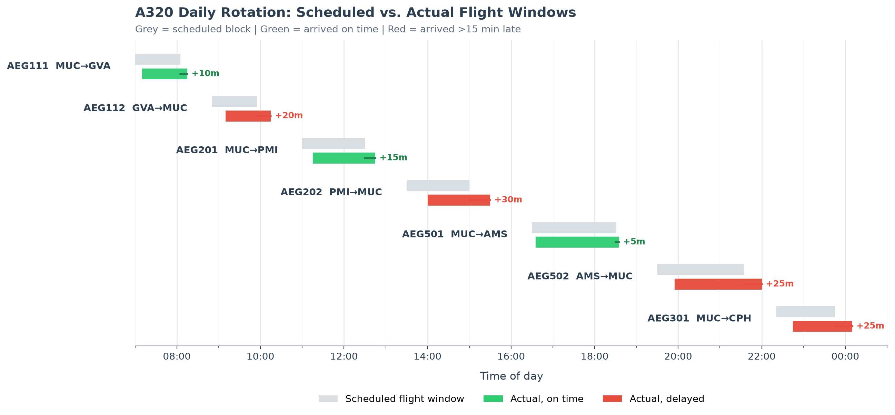
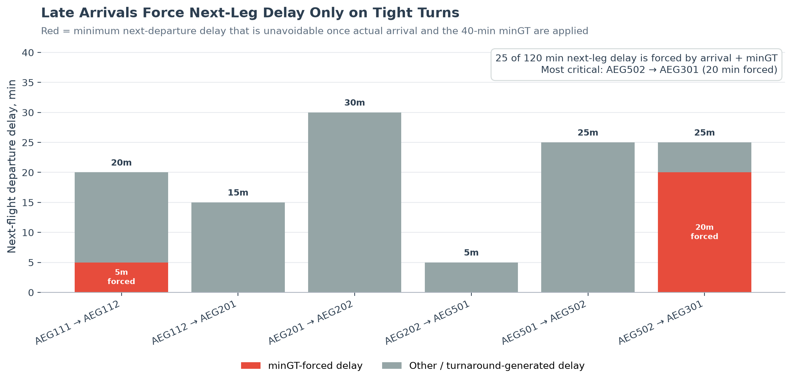
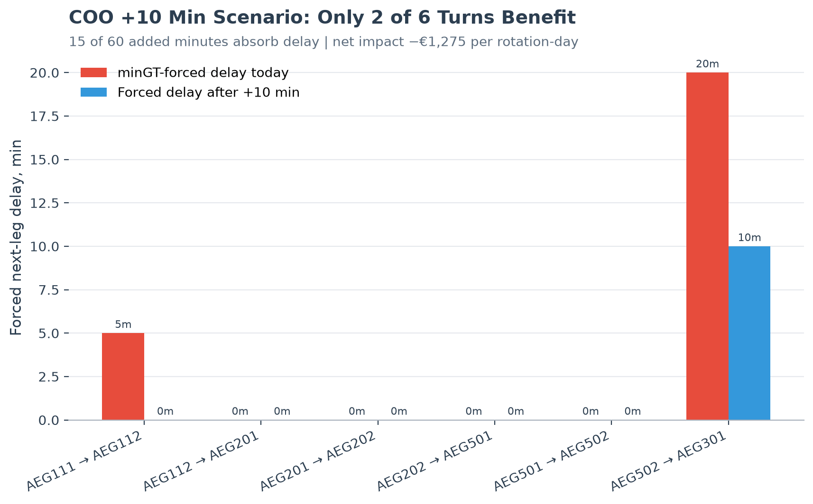
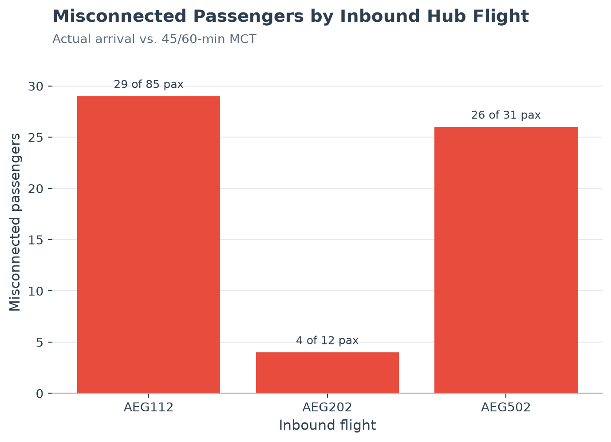
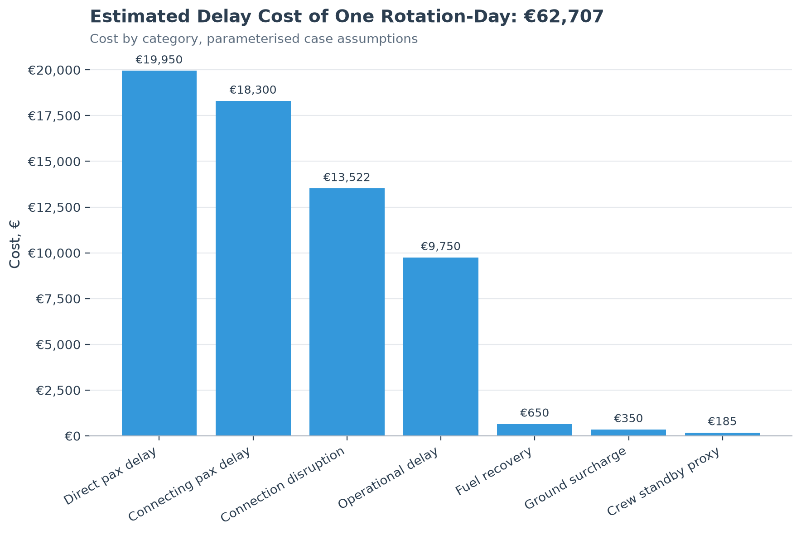

# Aircraft Rotation Delay Analytics

**Does adding 10 minutes of ground time to every turnaround pay off?** This case study answers a COO's punctuality question
for a fictional hub carrier. It follows one A320 through its day, traces how delay moves from leg to leg and into hub
connections, puts a euro value on it, and tests the proposed fix.



## Key findings

| # | Finding |
|---|---|
| 1 | **3 of 7 flights** arrived on time (≤ 15 min). The worst leg, PMI–MUC, was +30 min. |
| 2 | Only **25 of 120 min (21%)** of next-leg departure delay is *structurally forced* by a late arrival plus the 40-min minimum ground time. The other 79% is generated during the turnaround itself. |
| 3 | **59 of 128 connecting passengers (46%)** misconnect at the hub under 45/60-min MCT rules. |
| 4 | Delay costs about **€62.7k per rotation-day**. Passenger delay and connection disruption make up most of it, not operational cost. |
| 5 | The COO's **+10 min everywhere** absorbs only **15 of 60 added minutes**: 2 of 6 turns benefit, and the net impact is **−€1.3k per rotation-day**. |
| 6 | **Recommendation:** protect the few tight turns (above all the late-evening AMS → MUC → CPH turn) and treat turnaround-generated delay as a ground-process problem, instead of buffering every turn. |

<p align="center">
  
  
</p>

## Method

The core idea separates *arrival delay* from *propagated delay*:

```text
earliest feasible next departure     = actual arrival + minGT (40 min, A320)
minimum unavoidable next-dep. delay  = max(0, earliest feasible next departure − next scheduled departure)
```

A late arrival only harms the next leg when it eats into the minimum ground time. Everything above that floor comes from the turnaround.

| Step | What it does |
|---|---|
| Feature engineering | Timestamp parsing with after-midnight roll-over, delays, economy/business passenger split |
| Rotation diagnostics | Gantt chart of scheduled vs. actual windows, delay development, passenger exposure |
| Propagation model | Exact minGT logic per turnaround, splitting forced from turnaround-generated delay |
| Connection model | Actual inbound arrival vs. continental/intercontinental MCT for 18 onward connections |
| Cost model | Parameterised cost per flight and per connection (operational, passenger, fuel, ground, crew standby, rebooking, hotels, claims) |
| Scenario | COO +10 min ground time: absorbed delay vs. opportunity cost of block time, plus an upper-bound fleet scaling |
| ML pipeline | scikit-learn `Pipeline` (one-hot + scaling + random forest) with leave-one-out CV against dummy baselines |

<p align="center">
  
  
</p>

## Repository structure

```text
├── data/
│   ├── rotation.csv          # 7 flights of one A320 rotation
│   └── connections.csv       # 18 onward connections at the hub
├── figures/                  # all charts, regenerated by the notebook
├── notebooks/
│   └── rotation_delay_analytics.ipynb
└── requirements.txt
```

## Run it

```bash
git clone https://github.com/smugAlex/airline-rotation-delay-analytics.git
cd airline-rotation-delay-analytics
python -m venv .venv && source .venv/bin/activate
pip install -r requirements.txt
jupyter lab notebooks/rotation_delay_analytics.ipynb
```

Every cost assumption sits in one `ASSUMPTIONS` dictionary. Change a value and re-run to see the sensitivity.

## Limitations

* **One aircraft-day.** The findings show the method; they are not statistically robust. The fleet scaling is an upper bound because the sample day is disrupted.
* **The ML section is a template, not a model.** With n = 7, leave-one-out MAE (6.5 min vs. 8.6 min baseline) cannot be trusted. The notebook lists the data a production model would need: 12–24 months of tail-level history, weather, ATC, crew and connection data.
* The cost parameters and MCT rules come from the case brief. The +10 min scenario is first-order and ignores knock-on effects further down the rotation.

## Data

"Aerogermania" and all flights, passenger figures and cost parameters are **fictional case-study data**. They do not describe any real airline.

## Tech

Python · pandas · NumPy · matplotlib · scikit-learn · Jupyter
